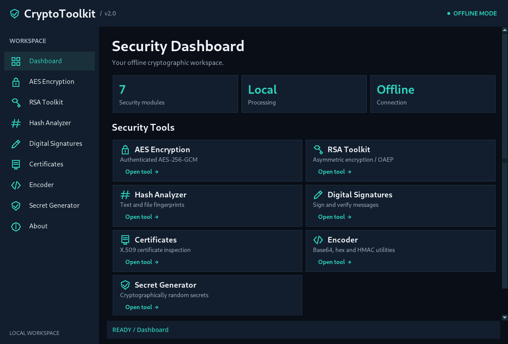

# CryptoToolkit 2.0

[](https://github.com/aboubakr-mikou/crypto-toolkit/actions/workflows/tests.yml)


**Local security workbench for cryptography and authorized security assessments.**

**Local security workbench for cryptography and authorized security assessments.**

A Python desktop application developed from an academic cryptography project. The redesigned interface offers offline utilities for inspecting data and demonstrating cryptographic operations.

## Screenshots

Actual application running on Linux (appearance may vary on Windows).




## Features

| Module | Capabilities |
|---|---|
| AES | AES-256-GCM authenticated text encryption, random keys, Base64 ciphertext |
| RSA | RSA-2048 OAEP with SHA-256, session keys and short messages |
| Integrity | Text and file SHA-256/SHA-512, legacy MD5/SHA-1 comparison |
| Signatures | RSA-PSS signing and verification with session keys |
| Certificates | PEM/DER inspection, self-signed lab certificates, encrypted private key export |
| Utilities | Base64, hexadecimal, random tokens and HMAC-SHA256 |

## Installation

Requires Python 3.10+ with Tkinter (included in standard Windows Python installations). On Debian/Ubuntu install `python3-tk` and `python3-venv` if needed.

Download and extract the repository using **Code → Download ZIP**, or clone it once published. Open a terminal in the extracted project directory.

Windows PowerShell:

```powershell
py -m venv .venv
.\.venv\Scripts\python.exe -m pip install -r requirements.txt
.\.venv\Scripts\python.exe main.py
```

Linux/macOS:

```bash
python3 -m venv .venv
.venv/bin/python -m pip install -r requirements.txt
.venv/bin/python main.py
```

## Usage

Choose a module in the sidebar. Generate a key before encrypting or signing. Copy ciphertext into the input to decrypt it with the same key. RSA and signing keys live in memory and are lost when the application closes. Keep AES keys securely if you need to decrypt later. Page inputs and outputs remain in memory while navigating; clear sensitive data and close the application after use. Use output as input to quickly reverse an operation. Text imports are limited to 2 MiB. Exports may contain sensitive information. File hashes can be compared with a trusted reference. Certificate inspection does not validate trust chains or hostnames.

## Quick start (Windows)

Double-click `launch.bat` after extracting the ZIP. It creates a virtual environment and installs the required dependency on first use (internet required for installation). Subsequent launches reuse the environment.

## Tests

```bash
python -m unittest discover -s tests -v
```

GUI tests require a graphical display; on Linux use `xvfb-run -a python -m unittest discover -s tests -v` for headless testing.

## Architecture

- `main.py`: application entry point
- `gui/`: Custom-styled Tkinter desktop interface with dashboard, vector icons and scrollable workspaces
- `core/`: cryptographic logic, including legacy educational modules
- `tests/`: automated tests and original demonstration script

## Author

Aboubakr Mikou — ENSA Fès. [GitHub](https://github.com/aboubakr-mikou) · [LinkedIn](https://www.linkedin.com/in/aboubakr-mikou-8441bb381).

## Security considerations

Educational tool; not independently audited or intended for production key management. No network operations or telemetry. AES-GCM uses fresh random nonces; ciphertext uses the toolkit's own format (nonce followed by ciphertext and tag, Base64 encoded, fixed associated data). MD5 and SHA-1 are for legacy comparison only. Self-signed certificates are for local labs, not proof of identity. Legacy AES-CBC and unencrypted key-export methods remain in the original core for educational reference, but are not exposed in the redesigned GUI. Clipboard contents may remain accessible to other applications. Never commit private keys or real secrets.
