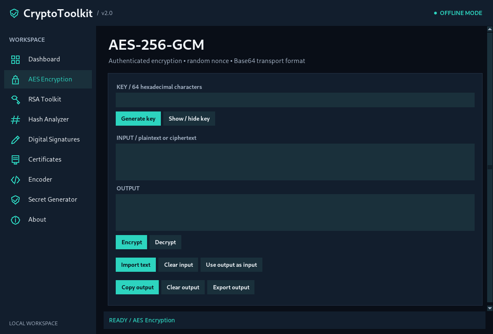

<h1 align="center">CryptoToolkit 1.0</h1>

<p align="center">
  <b>Offline Cryptography & Cybersecurity Workbench</b>
</p>

<p align="center">
  <a href="https://github.com/aboubakr-mikou/crypto-toolkit/actions/workflows/tests.yml">
    
  </a>
  
  
  
  <a href="LICENSE">
    
  </a>
  
</p>

---

## Overview

CryptoToolkit is a Python-based desktop application designed for cryptography, educational purposes, and authorized cybersecurity assessments.

Originally developed as an academic cryptography project at ENSA Fès, it has been redesigned into a modern security workbench offering practical cryptographic utilities through a dark-themed graphical interface.

The application operates entirely offline. All cryptographic operations and data processing are performed locally, without external requests or telemetry.

## Download

<p align="center">
  <a href="https://github.com/aboubakr-mikou/crypto-toolkit/releases/download/v1.0.0/CryptoToolkit.exe">
    
  </a>
</p>

<p align="center">
  <b>Windows x64 | No Python required | v1.0.0</b>
</p>

<p align="center">
  <a href="https://github.com/aboubakr-mikou/crypto-toolkit/releases">All Releases</a>
  |
  <a href="https://github.com/aboubakr-mikou/crypto-toolkit/releases/download/v1.0.0/SHA256SUMS.txt">SHA-256 Checksum</a>
</p>

### Verify Download Integrity

To verify the integrity of the downloaded executable, run the following command in PowerShell:

```powershell
Get-FileHash .\CryptoToolkit.exe -Algorithm SHA256
```

Compare the resulting hash with the value provided in `SHA256SUMS.txt`.

The executable is not digitally signed and may trigger a Windows SmartScreen warning. A matching checksum verifies consistency with the published checksum, not the identity of the publisher.

---

## Screenshots

### Security Dashboard


### AES Encryption Workspace



*Screenshots captured on Linux. Appearance may vary slightly on Windows.*

---

## Features

| Module | Capabilities |
| --- | --- |
| AES Encryption | AES-256-GCM authenticated encryption and decryption, random key generation, Base64 ciphertext |
| RSA Toolkit | RSA-2048 key generation, OAEP encryption and decryption with SHA-256 |
| Hash Analyzer | Text and file hashing, SHA-256, SHA-512, MD5 and SHA-1, integrity comparison |
| Digital Signatures | RSA-PSS signature generation and verification |
| Certificate Inspector | X.509 PEM/DER inspection, self-signed laboratory certificates and encrypted private key export |
| Encoder | Base64 and hexadecimal encoding and decoding, HMAC-SHA256 |
| Secret Generator | Cryptographically secure random secret and token generation |

### Additional Features

- Modern dark-themed graphical interface
- Offline and local processing
- Import and export utilities
- Clipboard integration
- Persistent workspace data during navigation
- Automated cryptographic and GUI tests
- Continuous integration with GitHub Actions
- Standalone Windows executable

---

## Tech Stack

### Programming & Interface


### Cryptography


### Development & Automation


---

## Installation from Source

### Prerequisites

- Python 3.10 or later
- Tkinter
- Git (optional when downloading the source ZIP)

### Clone the Repository

```bash
git clone https://github.com/aboubakr-mikou/crypto-toolkit.git
cd crypto-toolkit
```

Alternatively, download the source code using **Code → Download ZIP** and extract the archive.

### Windows — PowerShell

Create a virtual environment:

```powershell
py -m venv .venv
```

Install dependencies:

```powershell
.\.venv\Scripts\python.exe -m pip install -r requirements.txt
```

Launch the application:

```powershell
.\.venv\Scripts\python.exe main.py
```

### Linux — Debian / Ubuntu

Install the required system packages if necessary:

```bash
sudo apt update
sudo apt install python3-tk python3-venv
```

Create the virtual environment and install dependencies:

```bash
python3 -m venv .venv
.venv/bin/python -m pip install -r requirements.txt
```

Launch the application:

```bash
.venv/bin/python main.py
```

Compatibility with macOS has not been verified.

### Quick Start — Windows

After downloading or cloning the source code, double-click:

```text
launch.bat
```

The launcher creates a virtual environment, installs dependencies on first use, and starts CryptoToolkit.

Python and an internet connection are required for the initial setup.

---

## Usage

1. Launch CryptoToolkit.
2. Select a security module from the sidebar.
3. Generate or provide the required cryptographic key when applicable.
4. Enter or import the data to process.
5. Execute the desired operation.
6. Copy or export the result when necessary.

### Key and Data Management

- RSA and signing session keys are stored in memory and lost when the application closes.
- Store AES keys securely if you need to decrypt data later.
- Workspace data remains in memory while navigating between modules.
- Clear sensitive inputs and close the application after use.
- Text imports are limited to 2 MiB.
- Exported files may contain sensitive information.
- File hashes should be compared against trusted reference values.

---

## Project Architecture

```text
crypto-toolkit/
├── .github/
│   └── workflows/
│       └── tests.yml
├── core/
│   ├── __init__.py
│   ├── asymmetric.py
│   ├── certificate.py
│   ├── hashing.py
│   ├── signature.py
│   ├── symmetric.py
│   └── toolkit.py
├── gui/
│   ├── __init__.py
│   └── main_window.py
├── docs/
│   └── screenshots/
│       ├── dashboard.png
│       └── aes.png
├── tests/
│   ├── legacy_demo.py
│   ├── test_gui.py
│   └── test_toolkit.py
├── .gitignore
├── LICENSE
├── README.md
├── launch.bat
├── main.py
└── requirements.txt
```

The project separates cryptographic operations, graphical components, documentation, and automated tests to improve maintainability.

| Component | Responsibility |
| --- | --- |
| `core/` | Cryptographic operations and security utilities |
| `gui/` | Graphical interface and user interaction |
| `tests/` | Automated tests and original demonstration script |
| `docs/` | Application documentation and screenshots |
| `.github/` | Continuous integration workflow |
| `main.py` | Application entry point |

---

## Testing & Continuous Integration

CryptoToolkit includes automated tests for its cryptographic operations and graphical interface.

Run the test suite from an environment with the project dependencies installed:

```bash
python -m unittest discover -s tests -v
```

On Linux, GUI tests can be executed using a virtual display:

```bash
xvfb-run -a python -m unittest discover -s tests -v
```

GitHub Actions automatically runs the configured test suite on pushes and pull requests.

[View CI Workflow](https://github.com/aboubakr-mikou/crypto-toolkit/actions/workflows/tests.yml)

---

## Security Considerations

CryptoToolkit is an educational security utility and has not undergone an independent security audit. It is not intended for production key management.

- AES-GCM uses fresh random nonces and authenticated encryption.
- AES ciphertext follows the toolkit's own format: nonce, ciphertext and authentication tag, Base64 encoded, with fixed associated data.
- RSA encryption uses OAEP with SHA-256.
- Digital signatures use RSA-PSS.
- MD5 and SHA-1 are provided for legacy comparison only.
- Self-signed certificates are intended for laboratory use.
- Certificate inspection does not validate trust chains or hostnames.
- Legacy AES-CBC and unencrypted private key export methods remain in the original core modules for educational reference, but are not exposed through the redesigned GUI.
- Clipboard contents and exported files may expose sensitive information.
- Never commit private keys, passwords or real secrets to a repository.

Use this toolkit responsibly and only within authorized environments.

---

## License

This project is distributed under the MIT License.

See the [LICENSE](LICENSE) file for more information.

---

## Author

**Aboubakr Mikou**

Computer Science Engineering Student at ENSA Fès.

Interests: Cybersecurity, Artificial Intelligence, Cloud Computing and DevOps.

<p>
  <a href="https://github.com/aboubakr-mikou">
    
  </a>
  <a href="https://www.linkedin.com/in/aboubakr-mikou-8441bb381">
    
  </a>
  <a href="mailto:aboubakrmikou2411@gmail.com">
    
  </a>
</p>

---

<p align="center">
  <i>Built for learning, experimentation, and responsible cybersecurity.</i>
</p>
